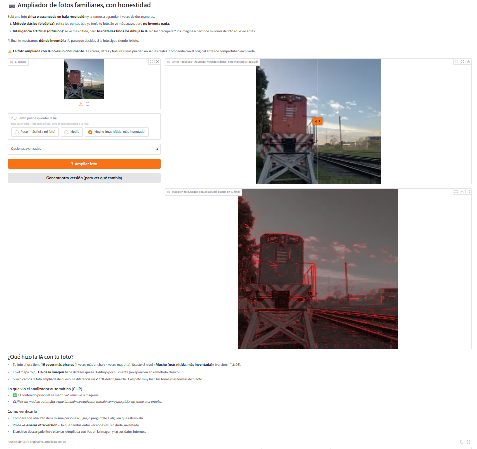

# 📷 Ampliador de fotos familiares, con honestidad

Herramienta que **agranda 4 veces** fotos familiares chicas o escaneadas en baja resolución
usando un **modelo de difusión**, y que **muestra qué parte del resultado inventó la IA**.

> Trabajo Integrador 2 · Procesamiento Digital de Imágenes · IFTS N.º 24 · 2026
> Autor/a: ✏️ COMPLETAR · Sub-tarea elegida: **A · Super-resolución**


<!-- ✏️ COMPLETAR: guardá una captura de la app funcionando en docs/capturas/app.png -->

---

## 1. El problema

Muchas familias tienen fotos viejas que solo existen como **archivos chicos** (escaneos
rápidos, fotos de fotos sacadas con el celular, imágenes reenviadas por WhatsApp). Al
agrandarlas se ven pixeladas. Las apps de "mejorar foto" las dejan nítidas, pero **no avisan
que los detalles nuevos fueron dibujados por la IA**: la cara de la abuela puede quedar
más joven, con otros ojos, o directamente parecerse a otra persona.

**Declaración del proyecto:** una herramienta local que permite a una persona sin
conocimientos técnicos ampliar fotos familiares de baja resolución, mostrando lado a lado el
resultado clásico y el de la IA, y marcando en un mapa qué detalles fueron reconstruidos por
el modelo, para que decida si la foto sigue siendo fiel antes de compartirla.

## 2. Persona usuaria

```
Nombre: Norma
Edad: 55-65 años
Ocupación: Administrativa jubilada; arma el archivo de fotos de la familia
Contexto tecnológico: Usa notebook y celular a diario (WhatsApp, Facebook, correo).
                      Nunca usó herramientas de IA para imágenes.

Problema actual:
"Escaneé el álbum de mi mamá con una app del celular y muchas fotos quedaron chiquitas.
 Cuando las agrando para imprimirlas o mandarlas al grupo de la familia, se ven todas cuadraditas."

Solución actual:
Probó una app de "mejorar fotos": quedaron nítidas, pero su hermana le dijo que el
papá "no parecía el papá". No sabe qué cambió ni por qué.

Frustraciones:
- No sabe qué parte de la foto "mejorada" es real y qué parte inventó el programa.
- Las herramientas profesionales tienen demasiadas opciones técnicas.

Objetivos:
- Agrandar fotos para imprimirlas y compartirlas sin traicionar el recuerdo.
- Poder elegir entre "más nítida" y "más fiel".
- Éxito = la familia reconoce a las personas de la foto ampliada.

Contexto de uso:
En su casa, los fines de semana, foto por foto. Tiene tiempo pero poca paciencia para configurar cosas.
```
<!-- ✏️ COMPLETAR: revisá la persona y ajustala con detalles tuyos; es tu decisión de diseño. -->

## 3. Cómo funciona (arquitectura)

```
 Foto de Norma
      │
      ▼
 preparar_imagen()      gira según EXIF, pasa a RGB, achica si supera 256 px (GPU) / 128 px (CPU)
      │
      ├──────────────► ampliar_bicubica()   ──► "solo tus píxeles" (línea base clásica, no inventa)
      │                                              │
      └──────────────► ampliar_con_ia()     ──► "con detalles de la IA" (difusión x4)
                                                     │
                    ┌────────────────────────────────┤
                    ▼                                ▼
   diferencia(bicúbica, IA)              fidelidad_al_original(original, IA)
   = mapa rojo de lo inventado           = ¿achicada de nuevo, se parece al original?
                    │                                │
                    └──────────► analisis.comparar() (CLIP: ¿cambió la calidad? ¿cambió el contenido?)
                                             │
                                             ▼
                 Informe en lenguaje simple + descarga PNG con el aviso «Ampliada con IA»
```

| Archivo | Qué hace |
|---|---|
| [app.py](app.py) | Interfaz Gradio y orden de los pasos |
| [restaurador/clasico.py](restaurador/clasico.py) | Procesamiento clásico: bicúbica, mapa de diferencias, fidelidad, PSNR, exportar con aviso |
| [restaurador/difusion.py](restaurador/difusion.py) | Modelo de difusión x4 |
| [restaurador/analisis.py](restaurador/analisis.py) | Análisis visual con CLIP (zero-shot) |
| [restaurador/textos.py](restaurador/textos.py) | Todo lo que lee Norma |
| [tests/](tests/) | Pruebas automáticas de la parte clásica |
| [notebooks/ejecutar_en_colab.ipynb](notebooks/ejecutar_en_colab.ipynb) | Ejecución en Colab + prueba de laboratorio con referencia |

## 4. Stack, modelos y hardware

| Componente | Versión | Licencia |
|---|---|---|
| Python | 3.12 | PSF |
| Gradio | 6.32.0 | Apache 2.0 |
| diffusers / transformers / accelerate | 0.43.0 / 5.23.0 / 1.15.0 | Apache 2.0 |
| PyTorch | 2.15.0 (local, CPU) · la de Colab (GPU) | BSD |
| Modelo de difusión: [`stabilityai/stable-diffusion-x4-upscaler`](https://huggingface.co/stabilityai/stable-diffusion-x4-upscaler) | — | CreativeML Open RAIL++-M |
| Modelo de análisis: [`openai/clip-vit-base-patch32`](https://huggingface.co/openai/clip-vit-base-patch32) | — | MIT |
| Código de este repositorio | — | [MIT](LICENSE) |

**Hardware con el que lo probé**
- Local: notebook con GeForce MX230 (**2 GB de VRAM**) y 8 GB de RAM → corren la interfaz,
  la parte clásica y CLIP, pero **no** el modelo de difusión (necesita ~3 GB solo de pesos).
- Google Colab con GPU **T4 (15 GB)** → corre todo el sistema. ✏️ COMPLETAR: tiempo por foto medido en Colab.

## 5. Instalación y uso

### En Google Colab (recomendado si no tenés GPU de 6 GB o más)
1. Abrí [notebooks/ejecutar_en_colab.ipynb](notebooks/ejecutar_en_colab.ipynb) en Colab
   (Archivo → Abrir cuaderno → GitHub → pegá la URL de este repositorio).
2. *Entorno de ejecución → Cambiar tipo → GPU T4*.
3. Ejecutá las celdas en orden y abrí el link `https://….gradio.live`.

### En local (con `uv`)
```bash
git clone https://github.com/USUARIO/restaurador-tpi2.git   # ✏️ COMPLETAR usuario
cd restaurador-tpi2
uv sync            # crea el entorno con Python 3.12 y las versiones exactas de uv.lock
uv run pytest      # (opcional) corre las pruebas
uv run app.py      # abre http://127.0.0.1:7860
```
Sin GPU funciona, pero la foto se limita a 128 px y cada ampliación tarda muchos minutos.

### Uso
1. Subí una foto (o elegí un ejemplo). 2. Elegí **¿Cuánto puede inventar la IA?**
3. Tocá **Ampliar foto**. 4. Deslizá el comparador, mirá el **mapa rojo** y leé el informe.
5. **Generar otra versión** repite con otro ruido inicial: lo que cambia es inventado.

✏️ COMPLETAR: capturas de ejemplos en `docs/capturas/` (comparador, mapa, informe).

## 6. Conceptos de procesamiento digital aplicados

| Concepto de la materia | Dónde |
|---|---|
| Imagen como matriz / canales RGB / luminancia | `clasico._a_gris`, `diferencia` (resta píxel a píxel con NumPy) |
| Muestreo e **interpolación bicúbica** (línea base) | `clasico.ampliar_bicubica` |
| Remuestreo para reducir (LANCZOS, BOX) y **aliasing** | `preparar_imagen`, `fidelidad_al_original`, creación de ejemplos |
| Orientación EXIF y metadatos de archivo | `preparar_imagen`, `exportar_con_aviso` (PNG con texto) |
| Ruido y **denoising** iterativo | modelo de difusión (`noise_level`, 25 pasos) |
| Umbralización | `porcentaje_cambiado` (píxeles con diferencia > 25 niveles) |
| Relleno de bordes (*padding* por repetición) | `difusion.rellenar_a_multiplo` |
| Métrica de similitud **PSNR** | `clasico.psnr`, prueba de laboratorio en Colab |
| Clasificación **zero-shot** con CLIP | `analisis.py` |

## 7. Decisiones de diseño (Human-AI Interaction)

| Principio | Decisión | Por qué, pensando en Norma |
|---|---|---|
| Transparencia | Dos resultados lado a lado: bicúbica ("solo tus píxeles") y IA | Ve qué agrega la IA respecto de lo que su foto realmente tenía |
| Control | Tres niveles con nombre ("Poco / Medio / Mucho") en vez de `noise_level` | No necesita entender parámetros; el valor por defecto es el más fiel |
| Explicabilidad | Mapa rojo + informe en palabras + porcentaje de foto cambiada | "El 12 % de la imagen lo dibujó la IA" es concreto |
| Honestidad sobre lo generado | Aviso fijo arriba, aviso si hay rostros y franja «Ampliada con IA» en el archivo descargado (también en los metadatos) | La advertencia viaja con la foto aunque Norma la reenvíe |
| Verificación | Botón **Generar otra versión** | Lo que cambia entre versiones es, sin duda, inventado |
| Progreso | Mensajes por etapa ("La IA está reconstruyendo detalles…") | La primera vez tarda varios minutos: que no piense que se colgó |
| Errores | Mensajes en lenguaje simple (sin foto, sin memoria) | Sabe qué hacer en lugar de ver un error técnico |
| Confianza | CLIP se presenta como "una pista, no una prueba" | No reemplazar un juicio humano por otro modelo que también se equivoca |

## 8. Qué es real y qué es inventado

**Qué hace el modelo.** El ampliador x4 parte de una imagen 4 veces más grande llena de ruido
y la "limpia" en 25 pasos, guiándose para que, al achicarla, se parezca a la foto de Norma.
Lo que **sí respeta** es lo que sobrevive en la foto chica: formas grandes, colores generales,
posición de las cosas. Lo que **no puede recuperar** es todo lo más chico que un píxel de la
foto original: pestañas, arrugas, texturas de tela, **letras y números**. Esos detalles **no
existen en el archivo**; el modelo los dibuja de forma plausible.

**Cómo se ve en la app.** El mapa rojo resta la imagen de la IA menos la bicúbica: en rojo
queda lo que la IA agregó y que no se deduce de los píxeles originales.
✏️ COMPLETAR: captura del mapa en `docs/capturas/mapa.png`.

**Qué advertencia le doy a Norma.** "La foto ampliada con IA no es un documento. Las caras,
letras y texturas finas pueden no ser las reales." Si CLIP detecta un rostro, se agrega un
aviso específico. El PNG descargado lleva la leyenda en la imagen y en sus metadatos.

**Un ejemplo en el que el modelo inventó.** ✏️ COMPLETAR con la prueba de laboratorio de
Colab (`ejemplos/locomotora_con_numero.jpg`): en la foto chica el número pintado de la
locomotora es ilegible; contá qué dígitos dibujó la IA, si coinciden con la foto real de
`ejemplos/referencia/`, y qué PSNR tuvo frente a la bicúbica.

**Un error del analizador.** Durante el desarrollo, CLIP clasificó la locomotora como
**"animal" (37,7 %)**, porque entre las frases candidatas no había ninguna de vehículos:
CLIP solo puede elegir entre las opciones que le damos. Agregué "vehículo o máquina". Es
otro caso de respuesta *creíble* pero no *verificable*.

**Riesgos de uso.** Una foto restaurada con IA no debería usarse como **prueba**, **documento
de archivo histórico** ni **noticia**: una matrícula, un texto o una cara reconstruidos
pueden parecer nítidos y ser falsos. En la escalera de la confianza, el resultado casi nunca
pasa de *creíble*; para que sea *verificable* hace falta otra fuente (otra foto, un
documento, alguien que estuvo ahí).

## 9. Uso de agentes de IA

Desarrollé el proyecto con **Claude Code** (agente en la terminal de VS Code), siguiendo la
lógica de *vibe engineering* de la consigna.

| Lo decidí yo | Lo propuso el agente (y lo revisé) |
|---|---|
| Sub-tarea A (super-resolución), persona del archivo familiar, ejecutar en Colab por falta de VRAM | Arquitectura en 4 módulos y nombres de funciones |
| Usar mis fotos del TP1 como ejemplos | Usar la bicúbica como "regla" y el mapa IA − bicúbica |
| ✏️ COMPLETAR: qué cambiaste o rechazaste | Botón "otra versión" para mostrar lo inventado; aviso en metadatos PNG |
| ✏️ COMPLETAR | Pruebas automáticas, cuaderno de Colab y este README como borrador |

Las instrucciones para el agente están en [AGENTS.md](AGENTS.md). Revisé y ejecuté todo el
código; puedo explicar cada función. ✏️ COMPLETAR: confirmalo cuando lo hayas leído entero.

## 10. Limitaciones conocidas

- La difusión **no corre en mi PC** (2 GB de VRAM): requiere Colab o una GPU de 6 GB o más.
- La foto se achica a 256 px de lado antes de ampliar (salida máx. 1024 px): fotos grandes pierden detalle.
- El mapa rojo es una **aproximación**: la bicúbica también suaviza, así que el mapa marca
  "lo que la IA agregó respecto de un método clásico", no una verdad absoluta.
- CLIP no fue entrenado para medir calidad y depende de las frases elegidas.
- No procesa fotos en lote ni colorea fotos en blanco y negro (fuera del alcance del MVP).

## 11. Problemas frecuentes

| Síntoma | Solución |
|---|---|
| `invalid peer certificate: UnknownIssuer` al hacer `uv sync` | La red o el antivirus intercepta HTTPS: `uv sync --system-certs` |
| `OPENSSL_Uplink ... no OPENSSL_Applink` al iniciar la app (Windows) | Está definida la variable `SSLKEYLOGFILE`: borrala (`$env:SSLKEYLOGFILE=$null` en PowerShell) |
| "Se terminó la memoria de la placa de video" | Usá una foto más chica o Colab con GPU |
| La primera ampliación tarda mucho | Está descargando el modelo (~3 GB); las siguientes son más rápidas |
